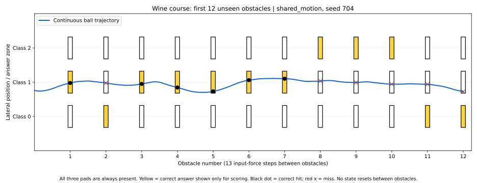

# Kinetra: dataset as one continuous obstacle course

**Implemented and tested. This first encoding does not solve the course.**
The best validated shared-motion models reach **38.0% correct hits** on held-out
Wine samples, with **38.9% nearest-class accuracy**. They settle on the most
common class. Neither mode wins a complete unseen course.

This experiment implements Christopher's current definition: the dataset is
the track, each example is a problem/obstacle, the ball is the model, and training
adjusts trajectory parameters to hit the correct part of every obstacle in one
continuous descent. It is separate from the earlier fixed-track,
input-conditioned experiments.

## How a dataset becomes a course

| Component | Implementation |
|---|---|
| One Wine example | One section containing 13 input-force steps and one obstacle |
| Input measurements | 13 sequential sideways forces, in the dataset's feature order |
| Fixed input encoder | Training-only standardization, then `force = 0.25*tanh(z/2.5)` |
| Answer zones | Three identical pads at lateral positions -1, 0 and +1 |
| Correct hit | Position within 0.32 of the correct class's pad at its obstacle |
| Prediction | Nearest pad; reported separately from actual correct-pad contact |
| Ball state | Position, velocity, angle and spin, carried between every obstacle |
| Trainable settings | Four launch settings; optionally six shared motion parameters |
| Training signal | Mean squared distance to correct pad centers, backpropagated after the full run |

**Answers never control the motion.** The encoder and simulator do not accept
labels. Every obstacle has all three answer pads, whatever its true class. All
contacts use the same label-independent smooth collision response. The label
only scores the completed trajectory and supplies the training loss.

There is one launch per complete course, no sample resets, no learned input map,
no per-example parameters, no learned class thresholds, no target attraction,
and no optimization at test time. A separate course restarts at the same saved
launch state. The state sequence is continuous within that course.

The equations are a deliberately small differentiable **toy simulation**:
forward progress is prescribed and lateral motion uses damping, torque, spin,
a centering spring, bounded position and a smooth contact impulse. This is not
a real rigid-body ball, and the Gaussian contact approximation has small tails
outside the hard scoring radius.

## Reproduce

From the repository root (Python 3.9+):

```bash
python -m pip install -r experiments/dataset-course/requirements.txt
python -m unittest discover -s tests -v
python experiments/dataset-course/kinetra_dataset_course.py
```

The script needs no flags, downloads no external dataset, and writes to
`experiments/dataset-course/results/`. Wine is bundled with scikit-learn.
NumPy performs the full forward simulation and exact reverse-mode gradient;
PyTorch is not required. The supplied figure additionally uses matplotlib.

The [protocol](PROTOCOL.md) was written before the benchmark. It fixes a
stratified **106 training / 36 validation / 36 test** split, five optimizer seeds,
250 Adam updates, two complete shuffled training courses per update, and
validation-based checkpoint selection. Test evaluation uses 20 orders of the
same 36 unseen rows per model. Those orders measure sensitivity to prior motion;
they do not increase the number of independent test examples.
The five seeds vary the initial launch settings; all six motion parameters
start at the same values, so the seed range is not a broad search over physics.

## Measured results

Means over five optimizer seeds, each evaluated on 20 test orders:

| Model | Trainable parameters | Correct-pad hits | Nearest-class accuracy | Fully won test courses |
|---|---:|---:|---:|---:|
| Untrained ball | 0 | 14.1% | 21.9% | 0 / 100 |
| Train launch only | 4 | 14.1% | 21.9% | 0 / 100 |
| Train launch + shared motion | 10 | 38.0% | 38.9% | 0 / 100 |
| Predict training-majority class | Standard baseline | N/A | 38.9% | N/A |
| Logistic regression | Standard baseline | N/A | 94.4% (34 / 36) | N/A |

The four launch settings are starting position, velocity, angle and spin. The
six additional shared parameters are force gain, torque gain, spin gain,
velocity retention, centering spring and lateral bias. They are fixed for the
entire inference course. Training them goes beyond an initial-state-only model,
which is why both modes are reported separately.

Validation selected **epoch 0** for all launch-only models and **epoch 20** for
all shared-motion models. The latter's test hit-rate range across seeds was
**37.92-38.06%**. All five shared-motion models predicted class 1 for every test
row in every tested order; improving the hit rate here did not learn to
distinguish the wine classes.

On the validation-selected illustrative model, shuffling test labels gives
**37.92%** hits and replacing all feature forces with zero gives **38.89%** hits.
These controls support the majority-class-collapse interpretation. The original
objective, a correct hit at every obstacle, was not met.

## What the trajectory shows



All pads exist in the simulation. Yellow merely highlights the scored answer
for the reader. The blue path stays near the middle pad; black dots are correct
hits and red crosses are misses. The complete 36-obstacle trajectory and hit
records are saved, even though the figure displays only the first 12.

Starting-state influence also fades rapidly in the fixed-dynamics model. For
seed 701's initial model, independently perturbing each raw launch parameter
by +/-1 produces a maximum position difference of about **0.495 at obstacle 1**,
**0.064 at obstacle 2**, **0.0000405 at obstacle 5**, and **9.2e-10 at obstacle 10**
on the test rows in their stored order. This label-free diagnostic is in
`launch_sensitivity.csv`. It explains a limitation of these particular damped
dynamics; it does not prove that every possible starting-trajectory model fails.

## Checks and interpretation

**13 automated tests passed**: nine new checks plus four existing regressions.
The new checks cover label-free forward interfaces, exact continuity when a
course is split and resumed with all state, deterministic replay, the influence
of inputs, pad scoring, train-only scaling/disjoint splits, batch independence,
soft-contact derivatives, and reverse-mode gradients against finite differences.

The conversion from dataset to course is implemented and reproducible. This
specific force encoding and small dynamics model is a failed learning attempt
on Wine, not evidence that Kinetra generally works or cannot work. In particular,
the damping suppresses launch influence, class positions impose an arbitrary
ordering, and the mean-squared-distance objective admits a middle-pad compromise.
Further work should address those limitations using training/validation evidence
and a newly reserved test set. The current test results were not used to retune
this run. Wine itself has appeared in earlier project experiments, so this is
not a pristine external dataset.

## Saved evidence

- [Summary and split/scaler provenance](results/summary.json)
- [All ten selected models and physical parameter values](results/models.json)
- [Per-seed results across train, validation and test orders](results/per_seed_results.csv)
- [Validation learning curves](results/learning_curve.csv)
- [Full continuous test trajectory](results/trajectory.csv)
- [Obstacle-by-obstacle predictions and hits](results/obstacle_hits.csv)
- [Launch-sensitivity diagnostic](results/launch_sensitivity.csv)
- [PNG figure](results/course_preview.png)
